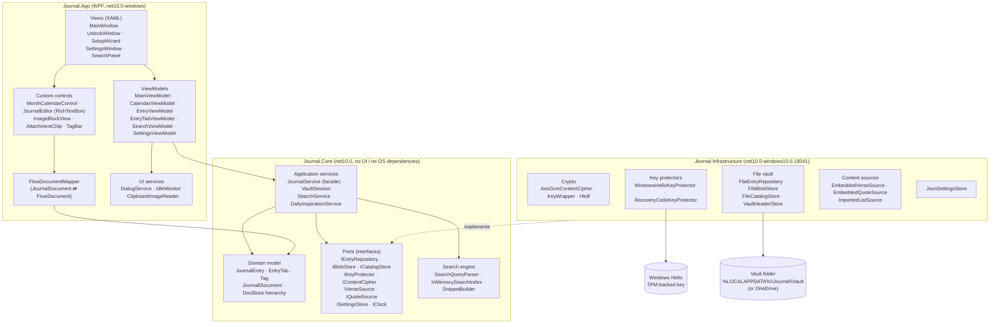
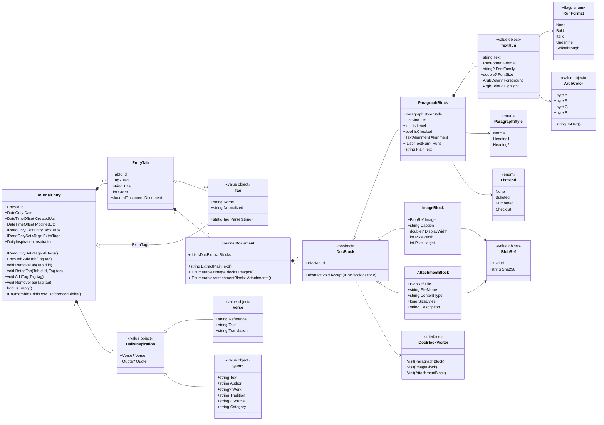
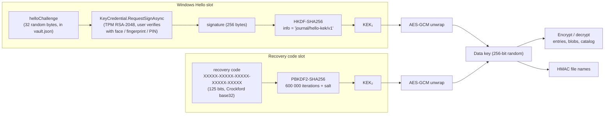
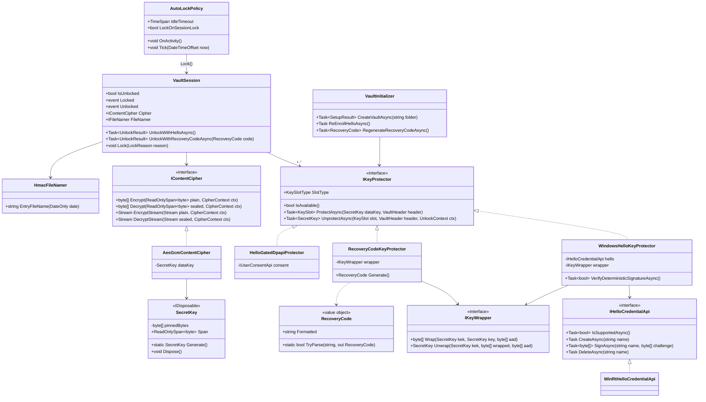
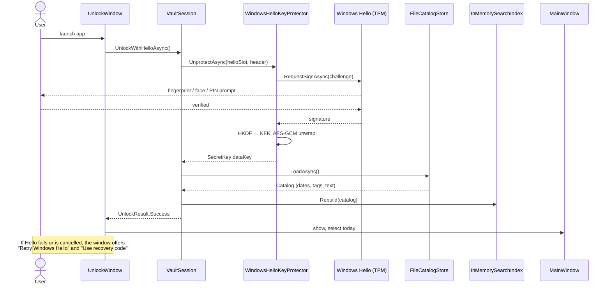
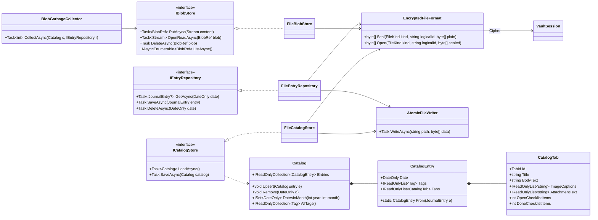
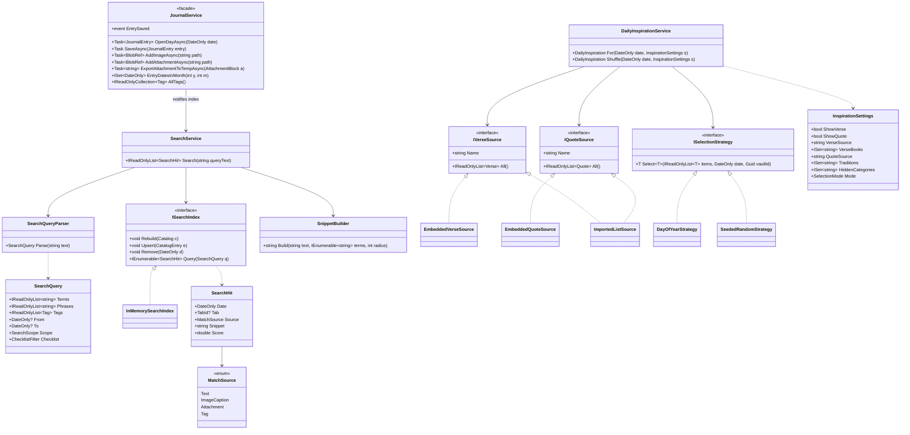
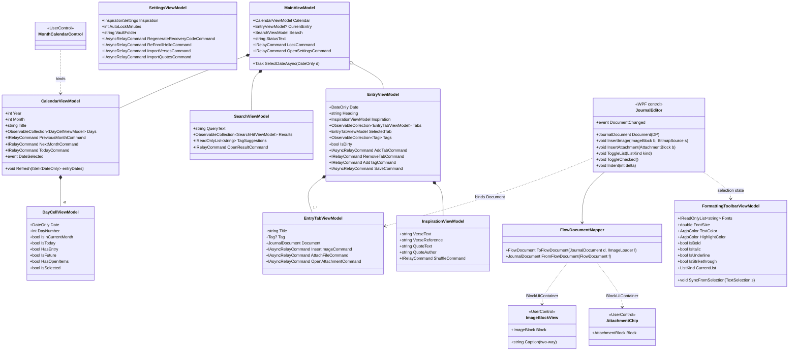

# Journal: Architecture & Design

| | |
|---|---|
| **Version** | 0.2 (open questions answered, awaiting approval) |
| **Date** | 2026-10-15 |
| **Platform** | Windows 10/11, .NET 10, WPF |
| **Status** | Awaiting approval. Requirements and test cases follow after approval. |

## 1. Purpose and scope

A private, single-user desktop journal and planner for Windows. Each calendar day, past or future, has at most one entry. An entry is written in a simple word-processor-style editor that mixes formatted text, lists and checklists, inline images (each with a searchable caption) and attached data files. An entry can be split into tabs, one per tag. A month calendar highlights the days that have entries. Every day shows a Bible verse and a philosophy quote, both configurable. Everything is encrypted at rest and unlocked with **Windows Hello** (fingerprint, face or PIN), so there is no journal password to remember.

**Out of scope for v1:** multi-user, cloud sync built into the app (the vault folder can be placed in OneDrive instead), mobile clients, collaborative editing, spell-check beyond what WPF provides.

## 2. Key design decisions

| # | Decision | Rationale |
|---|---|---|
| D1 | **.NET 10 WPF, MVVM** with CommunityToolkit.Mvvm and Microsoft.Extensions.DependencyInjection | Matches your toolchain; MVVM keeps UI logic testable. |
| D2 | **Layered architecture**: `Journal.Core` (no UI, no OS), `Journal.Infrastructure` (crypto, storage, Windows Hello), `Journal.App` (WPF) | Domain logic and search are unit-testable without Windows Hello or a UI. |
| D3 | **Own document model** (`JournalDocument` → `DocBlock` subclasses), mapped to and from WPF `FlowDocument` | Images and attachments become first-class objects with captions; avoids storing fragile XAML; makes text, captions and file names searchable. |
| D4 | **Envelope encryption**: one random 256-bit *data key* encrypts everything with AES-256-GCM. The data key is stored only in *wrapped* form, once per unlock method. | Lets us add or replace unlock methods (new PC, new fingerprint) without re-encrypting the journal. |
| D5 | **Primary unlock = Windows Hello key credential.** A TPM-backed RSA key, created with `KeyCredentialManager`, signs a fixed vault challenge. The signature is run through HKDF to produce the key that unwraps the data key. | The key never leaves the TPM and can only be used after a biometric/PIN check. No password. |
| D6 | **Backup unlock = 25-character recovery code**, shown once at setup for you to print or store in a safe place. | Windows Hello keys are tied to this PC and this Windows install. Without a recovery code, a new PC, Windows reinstall or TPM reset would lose the journal permanently. |
| D7 | **File-per-entry vault** (`entries/*.jent`, `blobs/*.jblob`) plus an encrypted **catalog** used for the calendar and search | Small writes per save, works well inside a OneDrive/backup folder, a corrupted file affects one day only. |
| D8 | **In-memory search index** built from the catalog on unlock | Encrypted data can't be indexed on disk in plaintext. A decade of entries is a few MB of text, so in-memory search is instant. |
| D9 | **Verse and quote are stored with the entry** once the entry is first saved | Past days keep showing the verse/quote you saw that day, even if you later change the settings. |
| D10 | **Built-in public-domain content**: verses from the **World English Bible (WEB)**, a modern-English translation, and quotes from classical authors (Marcus Aurelius, Seneca, Epictetus, Confucius, Lao Tzu, Plato, Aristotle, Pascal, etc.) and from world literature (Shakespeare, Tagore, Rumi, Dickinson, Machado de Assis, Olive Schreiner, etc.; ISS-011), plus user-importable lists | WEB reads as modern English and is public domain, so it can ship inside the app and work offline. The NRSV (the text of the *New Oxford Annotated Bible*), NIV and ESV are copyrighted and cannot be bundled; you can bring verses from a translation you own in through the import feature (§8.2). |
| D11 | **Any date can have an entry, including future dates** | The journal doubles as a planner: write plans and checklists on a future day, then tick them off. |

## 3. Architecture overview



**Dependency rule:** arrows point inward. `Journal.Core` references nothing else in the solution. `Journal.Infrastructure` implements Core's interfaces. `Journal.App` composes everything in `App.xaml.cs` through DI.

### 3.1 Solution layout

```
Journal/
├─ Journal.sln
├─ docs/                         Architecture.md, Requirements.md, TestCases.md
├─ src/
│  ├─ Journal.Core/              Domain, Documents, Search, Inspiration, Security (abstractions), Services
│  ├─ Journal.Infrastructure/    Crypto, Hello, Storage, Content (embedded verses.json, quotes.json), Settings
│  └─ Journal.App/               Views, ViewModels, Controls, Editor (FlowDocumentMapper), Services, Themes
└─ tests/
   ├─ Journal.Core.Tests/            xUnit: domain, document model, search, inspiration, session
   ├─ Journal.Infrastructure.Tests/  xUnit: crypto round trips, tamper detection, file vault, recovery code
   └─ Journal.App.Tests/             xUnit (STA): FlowDocumentMapper round trips, ViewModels with fakes
```

## 4. Screen design

```
┌──────────────────────────────────────────────────────────────────────────────────┐
│ Journal                                                   🔒 Lock   ⚙ Settings   │
├───────────────────────────┬──────────────────────────────────────────────────────┤
│  ◀   October 2026    ▶    │  Thursday, October 15, 2026                           │
│  Su Mo Tu We Th Fr Sa     │ ┌──────────────────────────────────────────────────┐ │
│               1  2  3     │ │ "Trust in Yahweh with all your heart..."         │ │
│   4 [5] 6  7 [8] 9 10     │ │                                  Proverbs 3:5 WEB │ │
│  11 12 [13]14 (15)16 17   │ │ "You have power over your mind, not outside      │ │
│  18 19 20 21 22 23 24     │ │  events."                     Marcus Aurelius   │ │
│  25 26 27 28 29 30 31     │ └──────────────────────────────────────────────────┘ │
│        [Today]            │  Tags: [family ×] [work ×] [+ add tag]               │
│ ───────────────────────── │ ┌─────────┬────────┬────────┬───┐                    │
│ 🔍 [tag:family garden   ] │ │ Journal │ family │ work   │ + │                    │
│                           │ ├─────────┴────────┴────────┴───┴──────────────────┐ │
│ Results (3)               │ │ Font▾ 12▾ A▾ ▇▾ │ B I U S │ H1 H2 • 1. ☐ │ 🖼 📎   │ │
│ ▸ Oct 13  family          │ │                                                  │ │
│   ...planted the garden.. │ │ Spent the morning in the garden with the kids.   │ │
│ ▸ Sep 28  caption         │ │ ┌──────────────────────────┐                     │ │
│   "Garden at sunrise"     │ │ │       [ photo ]          │                     │ │
│ ▸ Aug 02  family          │ │ │ Garden at sunrise ✎      │  ← caption         │ │
│                           │ │ └──────────────────────────┘                     │ │
│                           │ │ Then we went to church.                          │ │
│                           │ │ 📎 harvest-weights.xlsx (24 KB) — tomato yields  │ │
├───────────────────────────┴──────────────────────────────────────────────────────┤
│ Saved 10:42 · 3 tabs · auto-lock in 14 min                                        │
└──────────────────────────────────────────────────────────────────────────────────┘
  [5] = day with an entry (highlighted)   (15) = today / selected
  future days with an entry use the same highlight with a dashed outline (planned)
```

**Tabs and tags.** Every entry starts with one untagged tab named **Journal**. Adding a tab asks for a tag (autocomplete from existing tags); the tab is titled with that tag. The entry's tag set is the union of its tab tags plus any extra tags added on the tag bar, so an entry can be tagged without splitting it into tabs.

**Editor.** A `RichTextBox` with a small toolbar: font family, font size, text color, highlight color, bold, italic, underline, strikethrough, Heading 1, Heading 2, bulleted list, numbered list, checklist, Insert Image (file picker, paste from clipboard or drag-drop) and Attach File. Lists can be indented (Tab / Shift+Tab, up to 4 levels). A checklist item shows a checkbox you can tick with the mouse or Ctrl+Enter; ticked items are shown with strikethrough. The font list is the fonts installed in Windows; colors come from a 16-swatch palette plus a custom picker. Images are placed on their own line between paragraphs at the caret, with an editable caption beneath. Attached files appear as a chip showing the name, size and description; double-click opens it, right-click offers *Save As*, *Edit description* and *Remove*.

## 5. Domain and document model



**Invariants enforced by `JournalEntry`:**

- At most one entry per `DateOnly` (the date is the entry's natural key). Past, present and future dates are all allowed (D11).
- A run's null font, size or color means "use the default", so documents stay small and follow future theme changes.
- `IsChecked` is only meaningful when `List == Checklist`; consecutive list paragraphs with the same kind and level form one list, and numbering is computed when rendering, not stored.
- At least one tab; at most one untagged tab; no two tabs share a tag.
- Tags are case-insensitive, trimmed, 1–40 characters, no commas; `Tag.Normalized` is the lower-invariant form used for matching.
- Removing a tab or block does not delete its blobs immediately. Orphaned blobs are removed by `JournalService.CollectGarbageAsync` when the journal locks or unlocks, so undo inside the editor stays safe.

**Serialization:** `System.Text.Json` with polymorphic `DocBlock` (`[JsonDerivedType]` discriminators `p`, `img`, `file`) and a `formatVersion` field on every persisted object for future migrations.

## 6. Security design

### 6.1 Threat model

| Threat | Mitigation |
|---|---|
| Someone copies the vault folder or a backup | Every file is AES-256-GCM encrypted; keys are not on disk in usable form. |
| Someone uses the PC while you are signed in but away | Auto-lock after idle time (default 10 min), lock on Windows session lock / sleep, lock button. Unlocking requires Windows Hello again. |
| Tampering with or swapping encrypted files | GCM authentication tag; file kind and identity are bound in associated data, so a day's file cannot be renamed into another day. |
| Dates leaking through file names | Entry file names are `HMAC-SHA256(dataKey, date)`, not the date. |
| Lost PC, new PC, Windows reinstall, TPM reset | Recovery code unlock (D6), then re-enroll Windows Hello on the new machine. |
| Plaintext left on disk | Opened attachments are decrypted to a private temp folder and deleted on lock and on exit; stale ones are removed at startup. No plaintext caches or thumbnails are written. |
| Key material lingering in memory | `SecretKey` holds keys in pinned arrays and zeroes them on lock/dispose. (Managed memory gives no hard guarantee; this is best effort.) |

**Not protected against:** malware running as you while the journal is unlocked, or someone who can pass your Windows Hello check.

### 6.2 Vault format

```
<VaultFolder>/
├─ vault.json            plaintext header: formatVersion, vaultId, helloChallenge, keySlots[]
├─ catalog.jcat          encrypted: per-entry date, tags, tab titles, extracted searchable text
├─ entries/
│  └─ 3f9a…c1.jent       encrypted JournalEntry JSON (name = HMAC(date))
└─ blobs/
   └─ 7d0e…42.jblob      encrypted image or data file (name = blob GUID)
```

Every encrypted file: `magic "JRNL" | version (1 byte) | kind (1 byte) | nonce (12 bytes) | ciphertext | tag (16 bytes)`. Associated data = `magic | version | kind | vaultId | logical id` (date or blob id). Writes go to a temp file and are then atomically renamed, so a crash never leaves a half-written entry. Blobs larger than 64 MB are encrypted in 1 MB chunks (each its own GCM segment with a chunk index in the associated data) to keep memory bounded. Attachment size limit: 250 MB per file.

`keySlots[]` holds one wrapped copy of the data key per unlock method:

```json
{ "type": "windows-hello", "credentialName": "Journal.Vault.<vaultId>", "machine": "DESKTOP-ABC",
  "wrappedKey": "base64(nonce|ciphertext|tag)" }
{ "type": "recovery-code", "kdf": "PBKDF2-SHA256", "iterations": 600000, "salt": "base64",
  "wrappedKey": "base64(...)" }
```

### 6.3 Key derivation



**Why this works without a password:** Windows Hello key credentials sign with RSA PKCS#1 v1.5, which is deterministic, so the same challenge always produces the same signature, and only after you pass the biometric/PIN check. During setup the app signs the challenge twice and confirms the signatures match before relying on it. If a machine ever produced non-deterministic signatures, setup falls back to `HelloGatedDpapiProtector`: the data key is protected with Windows DPAPI (bound to your Windows account) and released only after a successful `UserConsentVerifier` check. That fallback is weaker and the setup screen says so.

**Windows Hello prerequisite:** Windows Hello must be set up (a PIN at minimum; fingerprint or face recommended). If it is not, setup explains how to enable it in Windows Settings and offers recovery-code-only mode until then.

### 6.4 Security classes



`IKeyProtector` is a **Strategy**: the session tries Windows Hello first and offers the recovery code as an alternative on the unlock screen. Tests use a `FakeKeyProtector` so nothing in the test suite needs real Windows Hello.

### 6.5 Unlock sequence



## 7. Persistence



**Saving:** the editor marks the entry dirty on every change. `JournalService` saves 2 seconds after the last keystroke, and also when you switch day, switch tab, lock or close. A save writes the entry file, then updates the catalog. If the catalog is ever missing or fails to decrypt, it is rebuilt from the entry files at unlock. An entry whose tabs are all empty is deleted rather than saved, so the calendar only highlights days with real content.

## 8. Services: search and daily inspiration



### 8.1 Search syntax

| Query | Meaning |
|---|---|
| `garden` | Entries containing *garden* in text, captions, attachment names/descriptions or tags |
| `"morning walk"` | Exact phrase |
| `tag:family` | Entries tagged *family* (entry tag or tab tag) |
| `tag:family garden` | Tagged *family* **and** mentioning *garden* |
| `in:captions sunrise` | Only image captions (also `in:text`, `in:files`) |
| `from:2026-01-01 to:2026-03-31 prayer` | Date range |
| `is:open` / `is:done` | Entries with unticked / ticked checklist items (useful for planning; combine with `from:today`) |
| `from:today` | Today and later (the keyword `today` works in `from:` and `to:`) |

Matching is case- and accent-insensitive, terms are combined with AND, and a term matches word prefixes (`gard` finds *garden*). Results are newest first, one row per tab that matched, with a highlighted snippet and an icon for where it matched (text, caption, file, tag). Clicking a result opens that day and tab. The search box also offers tag autocomplete, and clicking a tag chip anywhere runs `tag:<name>`.

### 8.1a Day mood (ISS-013)

Each day up to today can be marked sad, neutral or happy with three faces next to the day's heading. The mood is part of the encrypted entry (`JournalEntry.Mood`) and is copied into the encrypted catalog (`CatalogEntry.Mood`), so the calendar can tint days (light red for sad, light green for happy, with a small face on every marked day) and the summary under the calendar can count the last 30 days and the last 12 months without opening every entry. Choosing a face saves at once. Moods aren't part of search.

### 8.2 Daily verse and quote options

The quote card's label is the quote's category in capitals ("PHILOSOPHY", "LITERATURE"). Categories are data: each quote in `quotes.json` names its category, and the label, Settings and filters are built from the categories present (FR-INSP-17). The settings store the categories turned *off*, so a category added to the content later is shown until the user turns it off. Philosophy and literature quotes alternate in `quotes.json`, so the day-of-year mode, which only reaches the first 366 quotes, shows both.

| Setting | Options | Default |
|---|---|---|
| Show Bible verse | on / off | on |
| Verse source | Built-in World English Bible (≥ 366 verses) · imported list | Built-in WEB |
| Verse books filter | any subset of books (e.g. Psalms, Proverbs, Gospels) | all |
| Show a quote | on / off | on |
| Quote source | Built-in quotes (394 philosophy, 395 literature) · imported list | Built-in |
| Quote categories | one section per category in the content, Philosophy first (Philosophy, Literature; a future category such as Science appears with no code change), each with an *Include* tick box | all ticked |
| Traditions filter | per category: Stoic, Greek, Chinese, … for philosophy; English, Persian, Chinese, Latin American, African, … for literature. Saved as "Category/Tradition"; a category with none ticked keeps all its quotes | all |
| Selection | Same each year by day-of-year · Random per day (stable for that date) | Day-of-year |
| Per-day | **Shuffle** button for a new verse/quote today; it is saved with the entry | |

Import format: a JSON or CSV file (`reference,text,translation` for verses; `text,author,work,tradition,category` for quotes; a quote without a category is labelled "Quote"). Use this to bring in verses from a copyrighted translation you own, such as the NRSV from the *New Oxford Annotated Bible*. Imported lists are stored inside the encrypted vault.

## 9. Presentation layer



**How images sit between lines of text.** `FlowDocumentMapper` turns each `ImageBlock` into a `BlockUIContainer` that hosts an `ImageBlockView` (the picture with its caption box underneath) and tags the container with the block's id. Paragraphs map to `Paragraph`/`Run` with font family, size, colors, bold, italic, underline and strikethrough (`TextDecorations`). Headings map to styled paragraphs. Bulleted and numbered paragraphs map to nested WPF `List` elements (`MarkerStyle` Disc or Decimal). Checklist items map to a `Paragraph` whose first inline is an `InlineUIContainer` holding a `CheckBox`, so the tick sits on the same line as the text and moves with it. Inserting an image at the caret splits the current paragraph and places the image block between the two halves. Mapping back walks the `FlowDocument` and rebuilds the block list, so the stored format never contains XAML. Images are decoded at display size (`DecodePixelWidth`) to keep memory low; the original bytes stay encrypted in the blob store.

**Calendar highlighting.** `CalendarViewModel.Refresh` receives the set of dates that have entries (from the catalog) and sets `HasEntry` on each of the 42 cells. The control styles `HasEntry` with a filled accent background, `IsToday` with a ring, `IsSelected` with a bold outline, and days outside the month in a muted color. A future day with an entry (`IsFuture && HasEntry`) gets a dashed outline so planned days stand out, and a small dot marks days with open checklist items. Saving an entry raises `EntrySaved`, which refreshes the current month.

## 10. Cross-cutting concerns

| Concern | Approach |
|---|---|
| **Composition** | `App.xaml.cs` builds a `ServiceProvider`. Vault-dependent services are created after unlock; locking disposes them and returns to the unlock window. |
| **Single instance** | Named mutex; a second launch activates the existing window. |
| **Auto-lock** | `IdleMonitor` watches input in the app; `SystemEvents.SessionSwitch` and power events lock immediately. Unsaved changes are saved before locking. |
| **Error handling** | A file that fails to decrypt is reported for that day only ("This entry could not be read; it may be damaged") and never overwritten. Global handler logs and shows a friendly message. |
| **Logging** | `Microsoft.Extensions.Logging` to a rolling file in `%LOCALAPPDATA%\Journal\logs`. Never logs entry content, tags, captions or key material. |
| **Settings** | `%APPDATA%\Journal\settings.json` (vault location, auto-lock, inspiration options). Contains no journal content. |
| **Backup** | *Export backup* copies the encrypted vault folder to a zip. Restoring needs the recovery code (or the same PC's Windows Hello). |
| **Accessibility** | Keyboard navigation for calendar (arrow keys, PgUp/PgDn months), editor shortcuts (Ctrl+B/I/U, Ctrl+Shift+X strikethrough, Ctrl+Shift+L checklist, Ctrl+Enter tick item, Ctrl+F focuses search), AutomationProperties on custom controls. |
| **Theming** | Light theme in v1 with all colors in a resource dictionary so a dark theme can be added later. |

## 11. Design patterns used

| Pattern | Where |
|---|---|
| MVVM | All views/view models |
| Facade | `JournalService` hides repositories, blob store, catalog and index from view models |
| Repository | `IEntryRepository`, `IBlobStore`, `ICatalogStore` |
| Strategy | `IKeyProtector` (unlock methods), `ISelectionStrategy` (verse/quote choice) |
| Composite + Visitor | `JournalDocument` / `DocBlock` hierarchy; `IDocBlockVisitor` for text extraction, mapping and blob collection |
| Adapter | `FlowDocumentMapper` (domain ⇄ WPF), `WinRtHelloCredentialApi` (WinRT ⇄ testable interface) |
| Observer | `EntrySaved`, `VaultSession.Locked/Unlocked` events |
| Value Object | `Tag`, `BlobRef`, `Verse`, `Quote`, `RecoveryCode`, `DailyInspiration` |

## 12. Test strategy (detail comes with the test-case document)

| Level | Project | Examples |
|---|---|---|
| Unit | `Journal.Core.Tests` | Entry/tab/tag invariants, document text extraction, query parser, search ranking and snippets, verse/quote selection determinism, auto-lock timing with a fake clock |
| Integration | `Journal.Infrastructure.Tests` | Encrypt/decrypt round trip, tamper and swap detection, wrong-key failure, recovery-code wrap/unwrap, file vault save/load/delete in a temp folder, catalog rebuild, chunked large blobs, atomic writes |
| UI logic | `Journal.App.Tests` (STA) | FlowDocument ⇄ model round trips (fonts, colors, strikethrough, nested bulleted/numbered lists, checklists with ticked state, image between paragraphs, captions, attachments), calendar grid for any month, view models against fakes |
| Manual | Checklist | Real Windows Hello enrol/unlock/cancel, recovery on a second PC, auto-lock on Win+L |

Target: ≥ 85% line coverage on `Journal.Core`.

## 13. Third-party packages

| Package | Use | License |
|---|---|---|
| CommunityToolkit.Mvvm | MVVM source generators, commands | MIT |
| Microsoft.Extensions.DependencyInjection / Logging | Composition, logging | MIT |
| xUnit, xunit.runner.visualstudio, Microsoft.NET.Test.Sdk | Tests | Apache-2.0 / MIT |
| NSubstitute | Test doubles | BSD-3 |
| coverlet.collector | Coverage | MIT |

Crypto uses only built-in .NET (`AesGcm`, `HKDF`, `Rfc2898DeriveBytes.Pbkdf2`, `HMACSHA256`, `RandomNumberGenerator`). Windows Hello uses the built-in WinRT projection via the `net10.0-windows10.0.19041.0` target framework.

## 14. Risks

| Risk | Impact | Mitigation |
|---|---|---|
| Losing both the PC's Windows Hello key and the recovery code | Journal is unrecoverable (by design, nobody else can open it either) | Setup requires you to confirm part of the recovery code before continuing; Settings can show reminders and regenerate the code while unlocked. |
| Windows Hello prompt opening behind the WPF window | Confusing unlock | Bring the app to the foreground before the call and pass the window handle via the WinRT interop where supported. |
| Very large attachments | Memory and save time | Streamed, chunked encryption; 250 MB limit per file. |
| `RichTextBox` quirks with embedded controls (undo, copy/paste of image blocks) | Lost captions or images on paste | Custom clipboard handling for image blocks; covered by mapper tests and manual checks. |

## 15. Decisions from review (v0.2)

| # | Question | Decision |
|---|---|---|
| 1 | Tab model (default untagged *Journal* tab, one tab per tag, entry tags without tabs) | Approved as designed. |
| 2 | One-time recovery code at setup | Approved. |
| 3 | Vault location | `%LOCALAPPDATA%\Journal\Vault` by default; the setup wizard offers your OneDrive folder as a one-click option, and Settings can move the vault later. |
| 4 | Bible translation | **World English Bible** built in instead of KJV. The Oxford edition's text (NRSV) is copyrighted and can't be shipped in the app; it can be used through *Import verses* with text you own. |
| 5 | Editor features | Added fonts, font size, text and highlight colors, numbered lists, checklists and strikethrough (§4, §5, §9). |
| 6 | Future dates | Not blocked. The journal doubles as a planner: future entries are highlighted with a dashed outline and `is:open` finds unticked checklist items (§8.1, §9). |
